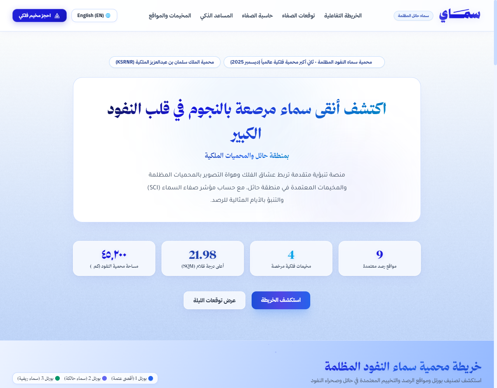
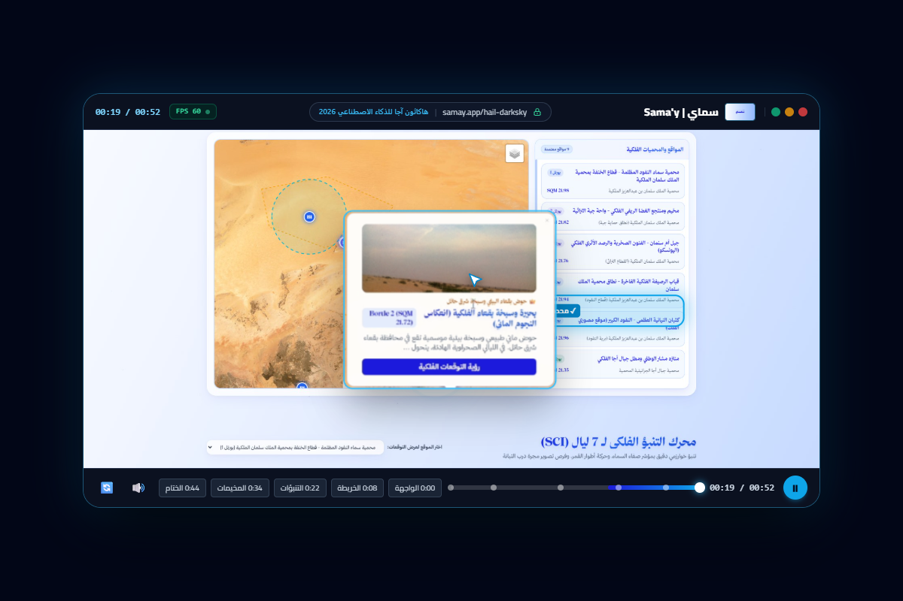
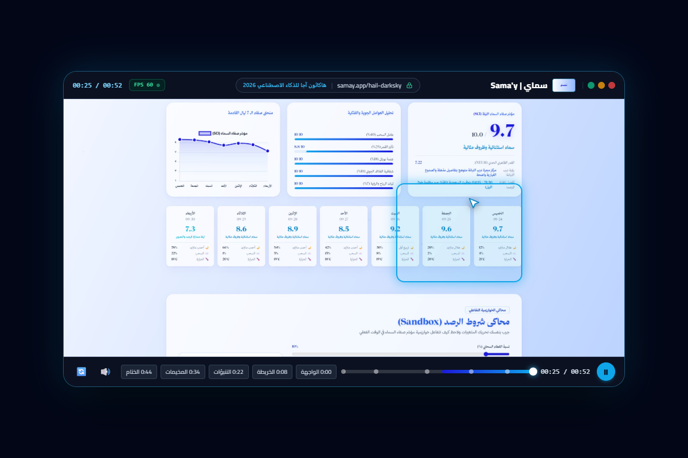
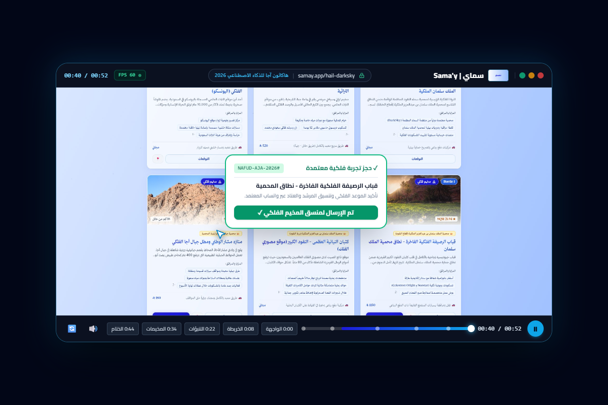

# Sama'y | Predictive Astro-Tourism Platform

An advanced predictive astrotourism and stargazing platform developed for the Aja AI Hackathon in Hail, Kingdom of Saudi Arabia.

---

## Executive Summary

Sama'y is an enterprise-grade, data-driven platform engineered to unlock the astrotourism potential of the Hail region and the Al-Nafud Al-Kabir desert. In December 2025, the Al-Nafud Dark Sky Reserve achieved international recognition as the second-largest dark sky reserve globally, spanning more than 45,000 square kilometers within the King Salman bin Abdulaziz Royal Natural Reserve (KSRNR).

Despite offering pristine skies with natural sky brightness readings exceeding 21.95 SQM (Bortle Class 1), astronomy enthusiasts, astrophotographers, and international eco-tourists often face logistical uncertainty regarding atmospheric clarity, moon interference, and access to verified observation sites.

Sama'y solves this challenge through a multi-tiered predictive analytics engine, combining real-time meteorological indicators, astronomical cycles, and geospatial mapping to generate a normalized Stargazing Clarity Index (SCI). The platform connects visitors with certified observation sites, heritage landmarks, and compliant astrotourism operators through an intuitive, bilingual web interface.

---

## Visual Documentation

### Platform Interface Overview


### Interactive Dark Sky Map


### Astrophotography Metrics Dashboard


### Campsite Directory and Booking Workflow


---

## Core Features

### 1. Interactive DarkSky Geospatial Map
- High-resolution cartography powered by Leaflet.js with dark-sky contrast styling.
- Comprehensive mapping of certified observation zones, including Jubbah UNESCO World Heritage sites, Jabal Umm Sinman, and deep dune corridors of the Great Nafud.
- Visual overlays detailing reserve perimeters, core preservation boundaries, and buffer zones.
- Interactive site markers detailing Bortle ratings, elevation, road accessibility, and available on-site equipment.

### 2. Algorithmic Celestial Metrics Engine
- Stargazing Clarity Index (SCI): A composite weighted index (1.0 to 10.0) calculating real-time atmospheric visibility based on cloud cover (40%), lunar phase and illumination (25%), light pollution baseline (18%), atmospheric transparency (10%), and surface wind turbulence (7%).
- Naked-Eye Limiting Magnitude (NELM): Algorithmic calculation of the faintest stars visible under prevailing conditions.
- Sky Quality Meter (SQM): Empirical sky brightness tracking across verified locations (up to 21.98 mag/arcsec²).
- Seven-Day Predictive Clarity Curve: Forward-looking forecast graphing optimal viewing windows, Milky Way galactic core visibility, and planetary conjunctions.

### 3. Interactive Condition Simulation (Sandbox)
- Parameter adjustment sliders allowing users and researchers to simulate changing meteorological inputs (cloud density, lunar percentage, Bortle class, humidity, wind velocity).
- Immediate recalculation of the SCI score, providing transparent insight into algorithm behavior.

### 4. Persona-Driven Recommendation System
- Tailored site matching based on visitor requirements:
  - Astrophotography (unobstructed horizons, zero light intrusion, stable ground).
  - Deep-Sky Astronomy (maximum Bortle 1 rating, high NELM, low atmospheric moisture).
  - Cultural and Family Astro-Tourism (paved road access, luxury dome accommodations, on-site guides).
- Algorithmic ranking of locations according to equipment criteria and user preferences.

### 5. Verified Operator Directory and Booking Workflow
- Curated index of licensed astrotourism camps, eco-lodges, and observation spots.
- Direct booking request dispatch connecting guests with local reserve coordinators via integrated messaging channels.
- Transparency regarding amenities (telescopes, guided tours, power sources, 4x4 transport).

---

## Technical Architecture

### Backend Architecture
- Framework: FastAPI (Python 3.10+) for high-throughput asynchronous request handling and OpenAPI documentation generation.
- Data Schemas: Pydantic models for strict type validation of geographic coordinates, meteorological telemetry, and booking inquiries.
- Algorithmic Engine: Pure-Python computational pipeline for astronomical and clarity scoring, isolated from persistence layers for microsecond latency.

### Frontend Architecture
- Core Structure: Semantic HTML5 engineered with comprehensive Arabic (RTL) and English (LTR) language switching.
- Styling: Tailwind CSS paired with custom CSS glassmorphism, responsive viewports, and tabular number formatting.
- Cartography: Leaflet.js integrating satellite imagery, vector polygon overlays, and custom cluster markers.
- Data Visualization: Chart.js for responsive rendering of the 7-day SCI predictive trajectory.
- Animation & Motion: Native requestAnimationFrame drivers for fluid numeric counters and cubic-bezier scroll transitions.

### System Directory Layout

```
sama-alnafud/
├── app/
│   ├── main.py                  # FastAPI application setup and API route definitions
│   ├── models.py                # Pydantic data models and request schemas
│   ├── engine.py                # SCI calculation algorithms and forecast generators
│   ├── recommendations.py       # Recommendation and persona scoring logic
│   ├── data_loader.py           # Geospatial data loader and query filters
│   └── static/
│       ├── index.html           # Single-page web application
│       ├── css/
│       │   └── style.css        # Responsive layout and glassmorphism styling
│       ├── js/
│       │   ├── app.js           # Client-side state, API client, and animations
│       │   └── map.js           # Leaflet map configuration and layer controls
│       ├── fonts/               # Local typography assets
│       └── images/              # Platform branding and icons
├── data/
│   └── spots.json               # Structured astronomical landmarks and campsites
├── screenshots/                 # Application interface documentation captures
├── tests/
│   └── test_engine.py           # Verification and unit tests for the SCI engine
├── requirements.txt             # Application dependency specifications
├── run.py                       # Server initialization entrypoint
├── .gitignore                   # Version control exclusion rules
└── README.md                    # Project documentation
```

---

## Scientific Standards and Data Sources

The platform aligns with international dark-sky conservation methodologies and official national frameworks:

1. DarkSky International Standards:
   - Measurement compliance with Sky Quality Meter (SQM) photometric specifications.
   - Classification based on the nine-level Bortle Dark-Sky Scale.
   - Evaluation of artificial sky brightness suppression in accordance with international reserve guidelines.

2. King Salman bin Abdulaziz Royal Natural Reserve (KSRNR):
   - Spatial grounding in the Al-Nafud sector conservation zones.
   - Alignment with sustainable ecotourism and desert heritage protection regulations.

3. Astronomical and Atmospheric Modeling:
   - Solar and lunar ephemeris calculations accounting for lunar phase angles and transit timing.
   - Atmospheric extinction and aerosol optical depth factors tailored to arid desert microclimates.

---

## Installation and Local Deployment

### Prerequisites
- Python 3.10 or higher
- Git version control

### 1. Clone the Repository
```bash
git clone https://github.com/your-username/sama-alnafud.git
cd sama-alnafud
```

### 2. Create and Activate Virtual Environment
```bash
# On Linux / macOS
python3 -m venv venv
source venv/bin/activate

# On Windows (Command Prompt / PowerShell)
python -m venv venv
venv\Scripts\activate
```

### 3. Install Dependencies
```bash
pip install -r requirements.txt
```

### 4. Run the Application
```bash
python run.py
```

The application will be accessible at:
- Web Application: http://127.0.0.1:8000
- Interactive Swagger API Documentation: http://127.0.0.1:8000/docs
- Alternative ReDoc Documentation: http://127.0.0.1:8000/redoc

### 5. Execute Test Suite
```bash
pytest
```

---

## API Reference Overview

The FastAPI backend exposes clean REST endpoints:

- `GET /api/spots`: Returns all verified astronomical landmarks, Bortle ratings, and coordinates.
- `GET /api/spots/{spot_id}`: Retrieves specific location metadata and amenities.
- `GET /api/forecast/{spot_id}`: Generates a 7-day predictive SCI score and meteorological breakdown.
- `POST /api/recommend`: Computes suitability rankings based on user persona and preference flags.
- `POST /api/sandbox`: Evaluates arbitrary atmospheric parameters to return simulated SCI scores.
- `POST /api/book`: Validates and registers booking inquiries for certified camps.
- `GET /api/stats`: Provides platform aggregate metrics (total reserves, area, peak SQM).

---

## Project Attribution

- Initiative: Developed for the Aja AI Hackathon 2026 (Hail, Saudi Arabia).
- Domain: Predictive Astro-Tourism and Night Sky Preservation.
- Regional Context: Hail Region, Al-Nafud Al-Kabir, King Salman Royal Natural Reserve (KSRNR).
